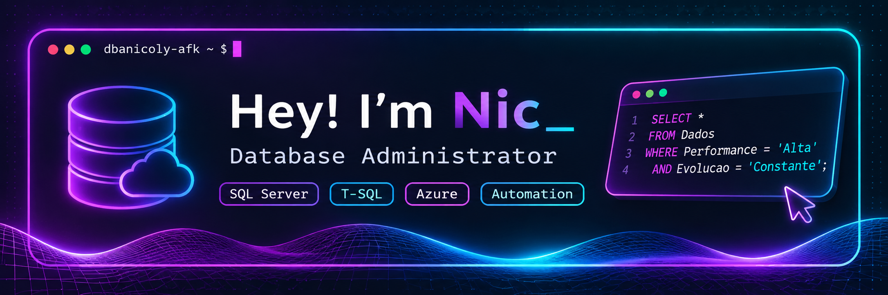

<div align="center">



<br><br>


<br>


<a href="https://www.linkedin.com/in/nicoly-gavila/">
  
</a>

</div>

---

## 💜 Sobre mim

```sql
SELECT
    'Nicoly Gavila' AS nome,
    'Nic' AS apelido,
    'Database Administrator' AS profissao,
    'SQL Server' AS tecnologia_principal,
    'Dados, Cloud e Automação' AS interesses,
    'Sempre aprendendo' AS mentalidade;
```

Oi! Eu sou a **Nic**, uma DBA apaixonada por tecnologia, bancos de dados e resolução de problemas. 💜

Atuo na administração e sustentação de ambientes **Microsoft SQL Server**, com foco em confiabilidade, performance e melhoria contínua.

No meu dia a dia, gosto de investigar incidentes, analisar consultas, otimizar processos e entender o que acontece por trás dos dados.

Atualmente, estou expandindo meus conhecimentos em **Microsoft Azure, automação e tecnologias de dados**.

<br>

## ⚡ O que eu faço

| 💾 Administração de Bancos | 🚀 Performance e Otimização |
|:---|:---|
| Administração SQL Server | Otimização de consultas |
| Backup e Restore | Análise de planos de execução |
| Migração de bancos de dados | Índices e estatísticas |
| Manutenção de bancos | Diagnóstico de bloqueios |

| 📊 Monitoramento e Confiabilidade | ☁️ Cloud e Automação |
|:---|:---|
| Monitoramento de ambientes | Microsoft Azure |
| Acompanhamento de jobs SQL | T-SQL |
| Investigação de incidentes | PowerShell |
| Análise de capacidade | Estudos de automação |

<br>

## 🛠️ Tecnologias e ferramentas

<div align="center">


<br><br>

**Administração de Dados • Troubleshooting • Performance • Cloud**

</div>

<br>

## ☁️ Minha jornada de aprendizado

```text
📂 Estudos da Nic
│
├── ☁️ Microsoft Azure
│   ├── AZ-900 | Em andamento
│   ├── DP-900 | Próximo objetivo
│   └── Azure SQL | Interesse
│
├── 💾 SQL Server
│   ├── Otimização de performance
│   ├── Troubleshooting
│   ├── Alta disponibilidade
│   └── Backup e recuperação
│
└── ⚙️ Automação
    ├── T-SQL
    ├── PowerShell
    └── Automação de rotinas DBA
```

<br>

## 📊 Minhas estatísticas

<div align="center">


<br>


</div>

<br>

## 🚀 Meu laboratório DBA

Estou construindo meu portfólio com estudos, laboratórios e scripts relacionados à administração de bancos de dados.

**Projetos em planejamento:**

- 🔍 Diagnóstico de saúde do SQL Server
- ⚡ Análise de performance, índices e estatísticas
- 💾 Diagnóstico de backups e restores
- 📊 Monitoramento de bancos de dados
- ☁️ Laboratórios de Microsoft Azure

> Os projetos serão desenvolvidos com exemplos genéricos e ambientes de laboratório, sem informações corporativas.

<br>

<h2 align="center">🐍 Minha jornada no GitHub</h2>

<div align="center">


</div>

## 🌐 Vamos nos conectar?

<div align="center">

<a href="https://www.linkedin.com/in/nicoly-gavila/">
  
</a>

<br><br>

### 💜 Obrigada pela visita!


<br>

**💜 Sempre aprendendo, sempre evoluindo.**

<sub>Feito com carinho, SQL e um pouquinho de café ☕</sub>

</div>
